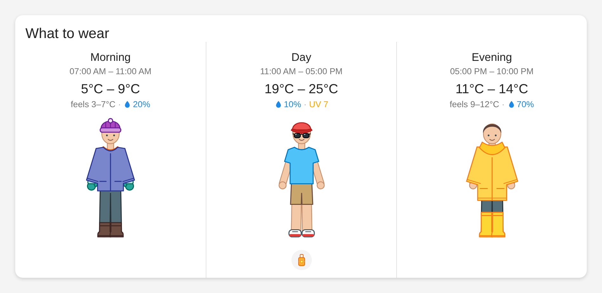
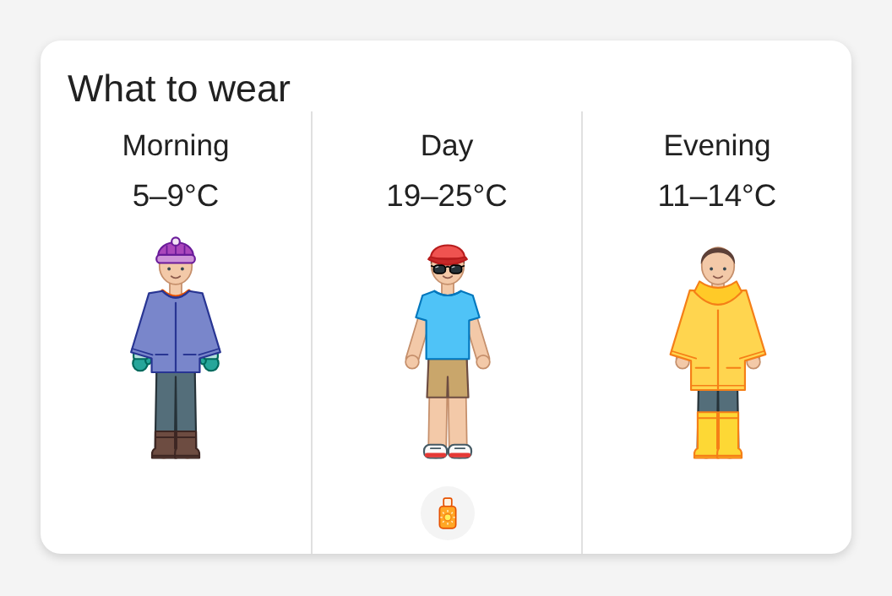
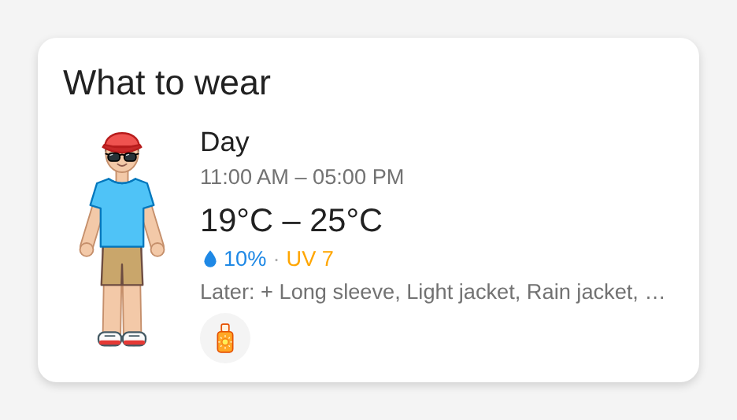
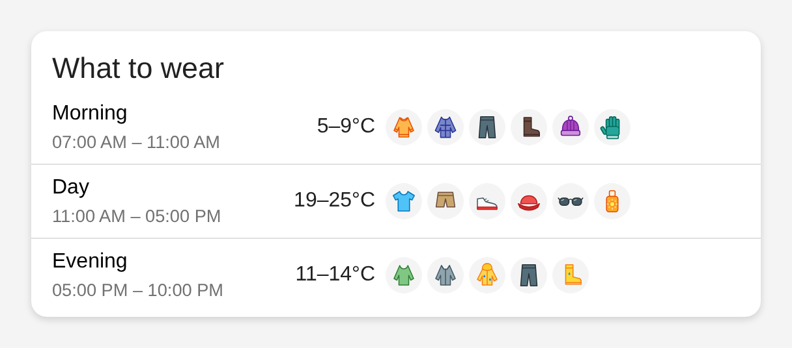
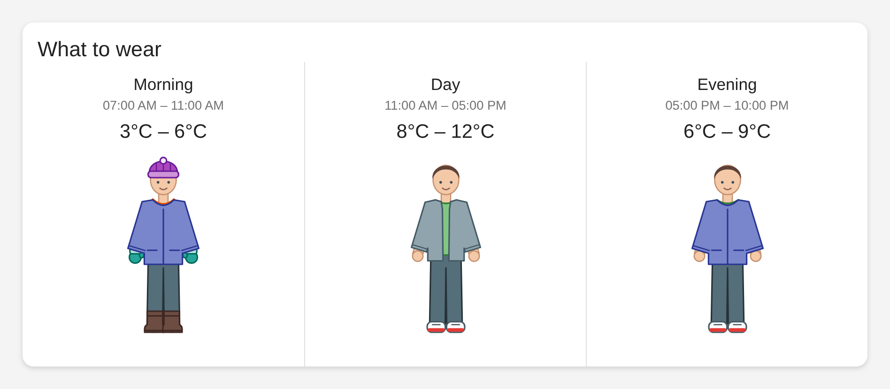

# Layercast

[](https://github.com/walnuss0815/ha-layercast/actions/workflows/ci.yml)

What should you wear today? Layercast turns the hourly forecast of any Home Assistant
weather entity into clothing recommendations for the periods of your day, using rules you
configure in the UI. Its Lovelace card shows a person dressed accordingly.



- Periods of the day (Morning, Day, Evening, ...) with their own recommendation.
- Rules per garment: temperature, feels-like, rain, wind, gusts, UV, humidity, weather
  condition. Groups pick one item out of several (one jacket, not three).
- A figure wearing the recommended clothes, with room for more figures (comic style, ...).
- Works with any weather entity that provides an hourly forecast, for example
  [DWD Weather](https://github.com/FL550/dwd_weather). Rules that need data your weather
  entity does not provide are not guessed, they are listed as unsupported.
- Feels-like is taken from the forecast, or calculated (wind chill, heat index) if the
  forecast has none.
- Fully configurable in the UI, English and German. No YAML.

Requires Home Assistant 2026.10 or newer.

## Installation

1. Install [HACS](https://hacs.xyz) (it is also available as the Marketplace in
   Home Assistant 2026.11 and newer).
2. Add `https://github.com/walnuss0815/ha-layercast` as a custom repository of type
   *Integration* and download **Layercast**.
3. Restart Home Assistant.
4. *Settings → Devices & services → Add integration → Layercast*, and pick your weather entity.

The default periods and rules are created for you. Change them any time.

## Configuration

Everything is on the integration's page under *Settings → Devices & services → Layercast*.
It lists your periods and your rules. Use the ⋮ menu next to an entry to change (*Reconfigure*)
or delete it, and *Add period* / *Add rule* to create new ones. A rule is edited in two steps:
name, image, group and priority first, then the weather conditions. Saving reloads the
integration, so the sensors and the card update right away.

### Periods

A period is a named time window. Each one becomes a sensor, for example
`sensor.layercast_home_morning`, whose state lists the recommended items. All sensors of a weather
entity share one device, so its area and name are set once.

- A period that is already over today shows tomorrow's.
- If the end is before the start, the period runs past midnight (22:00 to 06:00).
- The sensor attributes hold the items (name and image key), start and end, the weather values
  used (`temp_min`, `feels_max`, `rain_probability_max`, ...) and the rules that could not be
  evaluated (`unsupported`).

### Rules

A rule is an item (name and image) plus conditions. The image decides what the figure draws; with
a custom image URL the item is shown as a badge with that image instead. Leave a condition
empty to ignore it. **All filled conditions must match.**

| Condition | Matches when, within the period |
| --- | --- |
| Temperature at or below / above | the coldest / warmest hour reaches the value |
| Coldest temperature at or above | even the coldest hour reaches the value (shorts) |
| Feels-like at or below / above | same, using feels-like |
| Rain probability | the highest probability is at or above the value |
| Rain amount | the total is at or above the value (0.5 mm is DWD's threshold for rain) |
| Wind speed, gusts | the highest value is at or above the value (gusts of 39 km/h, Beaufort 6, make umbrellas hard to use) |
| UV index, humidity | the highest value is at or above the value |
| Weather condition | any hour has one of the selected conditions |

Units are °C, km/h and mm, whatever your weather entity uses.

**Groups and priority.** Within a group only the matching rule with the highest priority is
shown (on a tie, the one listed first). The defaults use this for the base layer, jacket, rain
gear, legs, shoes, head and sunglasses, so the figure never wears two jackets or two hats.

**Unsupported rules.** If a rule needs a value the forecast does not contain (say UV) and no
other condition of it already fails, it cannot be evaluated: it never matches and shows up in
`unsupported`. The card shows a warning, with the rule names on hover. A rule is only reported
if it could change the outcome, so a sun cap is not reported while a hat of higher priority in
the same group matched.

To get rid of a warning, either make the weather entity provide the value (see below), or edit
the rule and clear the condition that needs it, or delete the rule. `show_warnings: false` hides
the warning on the card.

The default rain rules use the rain amount, not the probability, because some sources do not
have one.

### Feels-like

If the weather entity gives a real per-hour `apparent_temperature`, it is used. Some sources
repeat one current value for every hour, which is ignored. Then Layercast calculates it: wind
chill at or below 10 °C, heat index at or above 27 °C (needs humidity), otherwise the plain
temperature. `values.feels_like_source` tells which one was used (`forecast`, `computed`, or
`temperature` if an input was missing).

### UV index

UV counts only while the sun is above 10° elevation. In the hours before and after, the UV of
the forecast is treated as 0. That matters because some sources, like dwd_weather, give one
daily maximum and repeat it for every hour: without this, sunscreen would be recommended for
the evening. A forecast without any UV value leaves UV rules unsupported.

### DWD Weather

dwd_weather provides temperature, rain amount, wind, gusts and conditions in its hourly forecast,
and UV for today and the next two days (one value per day; around a month change the next day
may be missing and UV rules are then unsupported). Humidity needs its *additional forecast
attributes* option. Its apparent temperature is a single current value, so Layercast calculates
feels-like itself.

With its *hourly update* option on, dwd_weather has **no rain probability** in the hourly
forecast (DWD publishes it only in the MOSMIX_L data, which hourly updates replace by MOSMIX_S).
That is why the default rain rules use the rain amount. If you edit rules, use "Rain amount"
rather than "Rain probability" with this source.

## Card

Add the card from the dashboard editor ("Layercast"), or in YAML:

```yaml
type: custom:layercast-card
title: What to wear
entities:
  - sensor.layercast_home_morning
  - sensor.layercast_home_day
  - sensor.layercast_home_evening
layout: auto
figure: neutral
show_weather: true
show_warnings: true
```

The integration registers the card itself, no resource to add. Tap a period to open its sensor
(the items, the weather values, the rules that could not be evaluated). Hover or tap a badge for
its name.

Items the figure has no layer for (sunscreen, your own rules, items with their own image URL)
appear as small badges below the figure, so nothing recommended is hidden.

### Views

`layout` selects the view. The default, `auto`, picks one by the width of the card, so the same
card works on a wall panel and on a phone, and follows you when you resize it in the sections view.

- **`timeline`**: a column per period with name, time, temperature, a line with feels-like, rain
  and UV, and the figure (the picture at the top).
- **`timeline-small`**: the same with smaller figures, name and temperature only. The time is on
  hover.

  
- **`compact`**: **one** period, the one running now, or else the next. A small figure, the
  weather, and what the later periods of the day add (the umbrella you need this evening).

  
- **`list`**: a line per period with the icons of the items instead of a figure.

  
- **`auto`**: `compact` under 320 px, `timeline-small` up to 520 px, `timeline` above. It switches
  with 20 px of leeway so it does not flicker at a limit. It never picks the list, which has no
  figure.

At night the compact view shows tomorrow's first period, marked "Tomorrow". A period that is not
today always carries its day ("Tomorrow 07:00", then the weekday). Below 260 px the compact view
puts the text under the figure.

In the sections view, `timeline` and `timeline-small` take the full width, `compact` and `list`
half of it, and `auto` the full width, which you can make narrower.

**What the weather rows show.** The line under the temperature has feels-like (only if it differs),
the rain and the UV, and leaves out whatever is missing. Rain is the probability, or the amount in
mm (in with imperial units) for a source without a probability. A row that none of the periods has
anything for is not drawn at all, so a night without UV or rain has no empty lines; if any period
has it, all of them have the row, so the figures line up.



**Options.**
- `show_weather: false` hides the temperatures and the line below them; the period, its time
  and the figure stay.
- `show_warnings: false` hides the warning about rules that cannot be evaluated. In the small views
  the warning is only an icon; the rule names show on hover.

### Figures

`figure` selects a built-in figure (`neutral`). To use your own, put a folder in
`config/www/`, for example `config/www/layercast/comic/`, and set
`figure_url: /local/layercast/comic`.

A figure is a body plus one transparent layer per garment, all on the same canvas so they line
up. The folder needs a `figure.json`:

```json
{
  "name": "Comic",
  "width": 160,
  "height": 320,
  "base": "body.svg",
  "layers": {
    "tshirt": { "file": "tshirt.svg", "z": 30 },
    "jacket": { "file": "jacket.svg", "z": 40 }
  }
}
```

- `layers` is keyed by the rule's image: `tshirt`, `long_sleeve`, `sweater`, `light_jacket`,
  `jacket`, `winter_coat`, `rain_jacket`, `umbrella`, `hat`, `sun_cap`, `gloves`, `sunglasses`,
  `trousers`, `shorts`, `thermal_trousers`, `sneakers`, `boots`, `rain_boots`. Leave out what
  your figure does not draw; those items become badges.
- `z` is the stacking order (higher is in front). The neutral figure uses legs 10, shoes 20,
  gloves 25 (so sleeves cover the glove cuffs), tops 30, jackets 40-45, hats 70, sunglasses 75,
  umbrella 80.
- Layers can be SVG or PNG. `figures/neutral/` in the integration is a template to start from.
- Several items are worn at once (a base layer under a jacket under a rain jacket, a beanie with
  sunglasses), so each outer layer must be a bit bigger than what it covers. `docs/figures.png`
  shows how the neutral figure's layers fit; with a checkout of this repository,
  `node docs/screenshot/figures.mjs --dir <your figure folder>` renders the same sheet for yours,
  and `LAYERCAST_FIGURE_DIRS=<folder> pytest tests/test_figures.py` runs the fit tests on it
  (see Development).
- Figures from comics or films are not bundled for copyright reasons, but you can draw your own.
- **With an AI coding agent:** this repository has an [opencode](https://opencode.ai) skill,
  `.opencode/skills/figure-generator/`, that draws a figure for you. It asks what the figure
  should look like, takes a reference picture, measures its proportions, draws every layer from
  a parametric template (`template/generate_figure.py`), and checks that all layers fit. The
  template also works on its own: `python .opencode/skills/figure-generator/template/generate_figure.py --out <folder>`
  draws a plain figure to start from. `measure_reference.py` prints the proportions of a
  reference picture, and `side_by_side.py` puts it next to a render of your figure.

## Development

```sh
nix-shell -p python314 uv
uv venv && uv pip install -r requirements-test.txt
.venv/bin/pytest
.venv/bin/ruff check . && .venv/bin/ruff format --check .
```

- **New built-in figure:** add a folder with a `figure.json` next to
  `custom_components/layercast/www/figures/neutral/` and list it in `FIGURES` in the card. A test
  checks that every layer file exists.
- **New card layout:** add an entry to `LAYOUTS` in `www/layercast-card.js`: a `render` function,
  its default `grid` size for the sections view and `size(n)` for the masonry view. It then
  appears in the card editor. `AUTO_LAYOUTS` and `AUTO_LIMITS` decide what `auto` picks.
- **Card tests:** `node --test tests/card.test.mjs` (Node 24, no dependencies).
- **Figure contact sheet:** `cd docs/screenshot && node figures.mjs` (set up like the screenshot
  below) renders every combination of layers to `docs/figures.png`, for checking how garments
  fit each other. `--dir <folder>` renders a figure from any folder (`--figure <name>` one from
  the integration's `www/figures`), `--set tops` one section, `--clip x,y,w,h --scale 4` a
  zoomed region. `LAYERCAST_FIGURE_DIRS=<folder>[:<folder>] pytest tests/test_figures.py` checks
  that the files exist and that the garments nest, for figures outside the repository too.
- **Screenshot and brand images:** `cd docs/screenshot && npm install --no-save playwright &&
  npx playwright install chromium && node render.mjs` renders `docs/screenshot.png` and
  `docs/views/*.png` from the real card with mock data (the page takes `?layout=`, `?width=` and
  `?scenario=`) (`node brand.mjs` does the brand images). The *Screenshot* workflow does
  the same in CI.

## Releasing

Releases are made by [Release Please](https://github.com/googleapis/release-please) from the
[Conventional Commits](https://www.conventionalcommits.org/) on `main`.

- It keeps a pull request open, "chore(main): release x.y.z", with the next version and the
  changelog. A `feat` raises the minor version, a `fix` the patch version, and a breaking change
  (`feat!:` or a `BREAKING CHANGE:` footer) the major version. The first release is `0.1.0`.
- A pull request that Release Please opens does not start the CI checks. Close and reopen it to
  run them, then merge it.
- Merging it creates the tag and the GitHub release, updates `CHANGELOG.md` and the version in
  `custom_components/layercast/manifest.json`. HACS offers the release.

## License

[Apache License 2.0](LICENSE)
